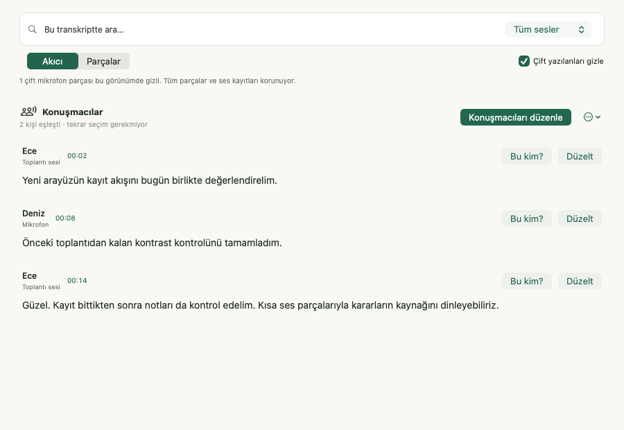
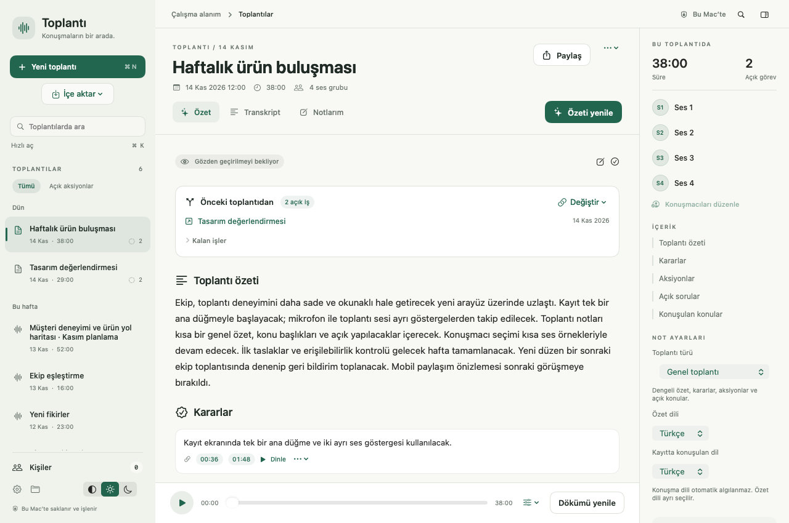
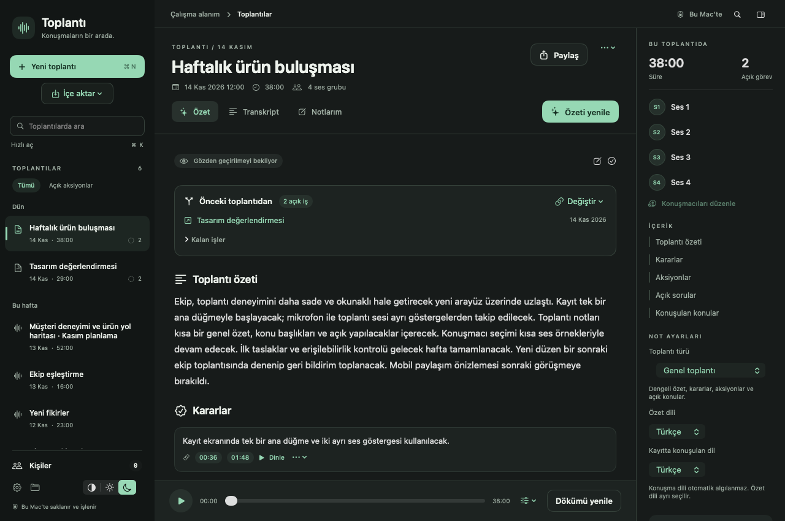

# Toplantı — MeetingDesk

Mac üzerinde toplantı sesini kaydeden, yazılı döküm ve kaynak bağlantılı toplantı notları oluşturan kişisel macOS uygulaması. Kaynak proje adı `MeetingDesk`, uygulamanın görünen adı **Toplantı**.

## Kurulum

**0.10.2 / yapı 25** için [GitHub sürümünü](https://github.com/AsFeanor/MeetingDesk/releases/latest) kullanın. 0.5.5 kuruluysa uygulamadaki **Güncellemeleri kontrol et…** seçeneğiyle güncelleyebilirsiniz. İlk kurulumda uygulamayı Uygulamalar klasörüne taşıyın. **0.5.3 ve önceki sürümlerden geçiş**, 0.5.5'te değişen imzalama anahtarı nedeniyle bir kez elle kurulum gerektirir. [Adım adım kurulum rehberi](docs/INSTALLATION.md).

## İşlerim, projeler ve toplantı serileri

Sol menüdeki **İşlerim**, bütün toplantılardaki aksiyonları tek yerde gösterir. Kişi, proje, seri, açık/tamamlanan durum ve toplantı tarihiyle süzün; arama görev, sorumlu ve yazılmış tarih metnini de kapsar. Tarih filtresi toplantının tarihidir; konuşmadaki “gelecek cuma” gibi ifadeler tahminle takvim tarihine çevrilmez. Tamamlanan iş kendi özgün toplantısında güncellenir. Sahibi veya tarihi belirtilmemiş maddeler açıkça gösterilir.

**Projeler** üzerinden proje ve düzenli toplantı serisi oluşturun. Toplantının sağ ayrıntı panelinden veya proje ekranındaki bağları düzenleme bölümünden üyeliğini seçin. Son iki görüşmenin notlarını yan yana, geçmiş kararları ve açık işleri toplantı bağlantılarıyla görebilirsiniz. Aynı serideki önceki görüşme, kalan işler için önerilir; bağlantı yine sen onaylayınca kaydedilir. Başlık veya kişi adına göre otomatik gruplama yapılmaz. Bir grubu silmeden önce bağlı toplantıları ayırın.

## Önemli anlar

Kayıt sırasında **Önemli an** düğmesiyle zamanı işaretleyip kısa not ekleyin. **⌘⇧M**, kayıt sürerken başka uygulamalardayken de işaret koyar; kısayol yalnız kayıt boyunca etkinleşir. Küçük kayıt kartında ve menü çubuğunda da işaretleme bulunur. İşaretler toplantının **Özet → Önemli anlar** bölümünde görünür; notları düzenlenebilir veya silinebilir. Kaydı dinlerken alt çubuktaki yer imi düğmesi de kullanılabilir.

Bir zamana tıklayınca birleşik kayıt o andan dinlenir; o anı kapsayan transkript bölümü varsa açılır. Ses saklama süresi dolmuşsa not ve metin bağlantısı korunur. İşaretler ses ve transkript dosyalarını değiştirmez.

## Toplantı geçmişine sor

Sol menüdeki **Sor** ile bir karar veya konuşulan konu hakkında soru sorun. Tüm arşiv, açık toplantı, proje veya seri seçilebilir. Sor’a bastığınızda ilgili konuşma bölümleri bulunup mevcut yerel Qwen modeliyle değerlendirilir; ek uygulama, API anahtarı veya yeni model gerektirmez. Model önceden hazırlanmamışsa Ayarlar’daki Özet modeli bölümünden indirilmelidir. Bu özellik, seçili özet modundan bağımsız olarak yalnız Mac’te çalışır.

Her yanıtta kısa açıklama, özgün alıntı ve toplantı/zaman bağlantısı gösterilir. Eşleşen kaynak bulunamazsa veya model yeterli kanıt görmezse yanıt üretilmez. En fazla 24 tam konuşma bölümü değerlendirilir; uzun bölümler kısaltılmadan atlanır ve sınır ekranda açıklanır. Görünen alıntının kaynağı doğrulanır; modelin anlam yorumunu özellikle önemli kararlar için kaynağı açarak kontrol edin. Soru ve yanıtlar toplantı dosyalarına yazılmaz. Model işlemi yalnız açıkça soru gönderildiğinde başlar.

## Kişisel terimler sözlüğü

**Sözlük** bölümünde doğru yazımı ve karşılaşılabilecek yanlış yazımları ekleyin. Transkriptteki **Yazım önerileri** veya toplantı menüsündeki **Terim düzeltmelerini gözden geçir…** ile eşleşmeleri açın. Önerinin önce/sonra metnini ve varsa sesini kontrol edip yalnız seçtiğiniz yazımı uygulayın. Tam kelime veya ifade eşleştirmesi kullanılır; belirsiz ya da çakışan eşleşmeler otomatik değiştirilmez.

Onaylanan düzeltmeden önce transkriptin geçmiş sürümü saklanır. Kaynak kimlikleri, sesler ve kişi seçimleri korunur; değişen metnin kelime zamanları temizlenir ve özetin yenilenmesi gerektiği belirtilir. Önceki döküme dön seçeneği kullanılabilir. Sözlük ve proje bilgileri yalnız yerel arşivde saklanır; yayın paketlerine eklenmez.

## Önceki işler ve kaynak sesleri

Toplantı notundaki **Önceki toplantıdan → Toplantı seç** ile ilgili önceki görüşmeyi bağlayın. Aynı başlıkta bir toplantı varsa öneri gösterilir; otomatik olarak ilgisiz işler bağlanmaz. **Kalan işler** listesinden tamamladığınız madde kendi özgün toplantısında işaretlenir. Daha eski açık işler, yalnız açıkça bağladığınız görüşme zincirinden gelir.

Kaynak bağlantısı olan karar, aksiyon veya konu metnine ya da yanındaki **Dinle** düğmesine tıklayarak 12 saniyeye kadar ilgili sesi dinleyebilirsiniz. Doğru mikrofon/sistem kaydı seçilir ve parça sonunda durur. Diğer kaynaklar açılır menüdedir. Silinmiş veya hiç kaydedilmemiş sesler için metin kaynağı kullanılmaya devam eder.

Transkriptte **Akıcı / Parçalar** ve **Tüm sesler / Mikrofon / Toplantı sesi** görünümleri bulunur. **Çift yazılanları gizle**, yalnız zamanları eşleşen uzun ve birebir kelime dizileriyle tamamen doğrulanan mikrofon tekrarlarını okuma görünümünden süzer. Özgün transkript, kelime zamanları, sesler ve kaynak kimlikleri korunur; kontrolü kapatarak tüm parçaları görebilirsiniz. Dışa aktarım tam metni zaman sırasıyla korur. Bu görünüm bir ses temizleyici veya yeni kelime tanıma modeli değildir.

Konuşmacı kontrolü artık yalnız belirsiz gruplarla başlar. Bilinen kişileri yeniden düzenlemek için **Bu kim?** veya tüm sesleri gözden geçirme seçeneği kullanılabilir. Son seçtiğiniz kişiye ait başka bir sesi dinledikten sonra tek düğmeyle aynı kişiyi onaylayabilirsiniz; bilinmeyen sesler adlarına göre otomatik birleştirilmez.



## Yeni çalışma alanı

Açık, koyu veya sistem görünümünü sol alt köşeden seçin. Toplantılar solda aranır; notlar ortada, dil/şablon ve içerik haritası sağdaki ayrıntı panelindedir. Dar pencerede sağ üstteki panel düğmesi ayrıntıları açar.

- **⌘K:** toplantı başlığı, kişi, transkript veya not içeriğiyle hızlı açma.
- **⌘1 / ⌘2 / ⌘3:** özet, transkript ve kişisel notlar.
- **Açık aksiyonlar:** bekleyen işi olan toplantıları süzme; toplantı içinde yalnız açık görevleri gösterme.
- **Transkriptte ara:** konuşma veya konuşmacı arama; kaynak bağlantıları aramayı temizleyip doğru bölüme gider.
- **Ayarlar:** kayıt, model, konuşmacılar, saklama, Notion ve güncellemeler ayrı bölümlerde.

Aşağıdaki ekranlar gerçek arayüzün yalnız sentetik örnek verilerle oluşturulmuş yerel görüntüleridir.



<details>
<summary>Koyu görünüm</summary>



</details>

## Kısa toplantı notları

**Ayarlar → Özet modeli** bölümünde önerilen Qwen3.5 9B seçeneğini kullanın. İlk kullanımda **Modeli hazırla / Modeli indir** ile yaklaşık 6,6 GB model bir kez indirilir. Özet motoru uygulama paketinin içindedir ve gerektiğinde arka planda kendiliğinden başlar; başka uygulama kurmak veya açmak, API anahtarı almak gerekmez.

Notlar kısa bir genel özet, konuya göre derlenmiş açıklamalar, son durumda geçerli kararlar ve yapılacaklardan oluşur. Tekrarlanan görevler birleştirilir; sorumlu ve tarih yalnız konuşmada açıkça bulunuyorsa yazılır. Şablon ve özet dili korunur. Modelin tam bağlamına sığmayan içerik sessizce kesilmez; işlem açıklayıcı bir hatayla durur ve önceki notlar korunur.

Model indirmesinden sonra özetleme bu Mac’te çevrimdışı çalışır. Apple Intelligence seçeneği eski, bölümler halinde çalışan temel özetleyicidir. Qwen için Apple Silicon ve en az 16 GB bellek önerilir. Model dosyaları mevcut `~/.ollama/models` önbelleğinde saklanır; bu konum başka uygulama kullanıldığı anlamına gelmez.

## Sesinden kişi tanıma

Ayarlar’daki **Konuşmacılar ve ses profilleri** bölümünden modelleri bir kez indirin. Bir toplantının transkriptinde **Konuşmacıları düzenle** seçeneğini açın: kısa örneği dinleyip kişiyi seçin veya isim ekleyin. Aynı kişi farklı örneklerde çıkarsa listeden aynı ismi seçebilirsiniz. İsterseniz yalnız o örnek için **Dinlediğim bu sesi sonraki toplantılarda tanı** seçeneğini açıkça onaylayın.

Kenar çubuğundaki **Kişiler** ekranında eklediğiniz kişileri arayabilir, ilgili toplantılarını açabilir ve hatırlanan ses profillerinin adını değiştirebilir veya sesini unutturabilirsiniz. Yalnız toplantıda isim verdiğiniz kişiler de listelenir. Profiller yalnız bu Mac’te saklanır. Ses kayıtlarının saklama süresi profilleri otomatik silmez. Bir sesi hatırlatmak yeni transkriptlerde otomatik tanımayı da açar; belirsiz eşleşmeler onay bekler. Konuşmacı veya isim düzeltmek tek başına profili değiştirmez.

## Neler yapıyor?

- Seçilen mikrofon ve Mac'te çalan sistem sesi birlikte kaydedilir. Mikrofon güçlendirmesi seçilebilir; birleşik, yalnız mikrofon ve yalnız sistem kayıtları saklanır.
- Türkçe veya İngilizce konuşma seçilen dilde Apple'ın yerel konuşma/dikte modeliyle yazıya çevrilir. Yerel döküm zaman damgalıdır; ayrı ses kaynaklarını etiketler, kişi kimliğini otomatik tanımaz.
- Qwen3.5 dökümü bütün olarak değerlendirip kısa genel özet, konu başlıkları, kararlar ve tekrarsız yapılacaklar oluşturur. İptal edilmiş veya tamamlanmış işler bekleyen aksiyon olarak sunulmaz. Kaynak bağlantıları ilgili konuşmaya götürür. Apple Intelligence ayrıca temel seçenek olarak seçilebilir.
- Kayıttan önce 10 saniyelik ses denemesi yapılabilir; deneme yalnız mikrofonu dinletir ve kapatıldığında geçici sesler silinir.
- Ayrı mikrofon ve sistem kayıtları ayrı çözülüp zaman sırasına birleştirilir. Kaynak etiketleri “Mikrofon” ve “Toplantı sesi”dir; karşı taraftaki kişileri tek tek tanımaz. Eski veya içe aktarılan birleşik kayıtlar açık bir bilgiyle birleşik olarak çözülür.
- Özet, kararlar, aksiyonlar, sorumlu/tarih, sorular, fikirler ve konular düzenlenebilir. Manuel düzeltmeler ve tamamlanan görevler yenilemede korunur; önceki not sürümüne dönülebilir. Kontrol edilen notlar işaretlenebilir.
- Paylaşım önizlemesinden özet/kararlar, yalnız aksiyonlar veya tüm notlar ve döküm seçilir; metin kopyalanabilir, Markdown ve çok sayfalı seçilebilir metin içeren PDF kaydedilebilir. Kişisel notlar varsayılan olarak paylaşılmaz.
- İsteğe bağlı otomatik hazırlama kaydı bitirince transkripti, ardından özeti **yalnız ücretsiz yerel modda** oluşturur. Özet/model hatası veya iptal, kaydedilmiş dökümü silmez.
- Arşivde başlık, döküm, kararlar, aksiyonlar, sorumlu/tarih, kişi adları ve kişisel notlar birlikte aranabilir.
- Genel, ekip, ürün ve müşteri şablonları hem özetin odağını hem bölüm düzenini değiştirir. Ekip şablonunda ilerleme/engeller, ürün şablonunda ihtiyaçlar/geri bildirim/seçenekler, müşteri şablonunda ihtiyaçlar/endişeler öne çıkar. Şablon değiştirdikten sonra **Özeti yenile** kullanılır; söylenmemiş sorumlu, tarih veya karar eklenmez.
- Ses kayıtları için isteğe bağlı 7/30/90/180/365 gün veya özel saklama süresi. Süresi dolan sesler Çöp Sepeti’ne taşınır; transkript, özet ve kişisel notlar korunur. Varsayılan kapalıdır.
- Sparkle ile uygulama içinden imzalı güncelleme denetlenir, indirilir ve kullanıcı onayıyla kurulur.

[İş akışı rehberi](docs/WORKFLOW.md).

### 0.5.5 ile gelenler

Yerel özetlerde geçerli aksiyonların boş kalmasına veya kaynak doğrulamasında işlemin durmasına yol açan sorun düzeltildi. Kaynakta doğrulanamayan isteğe bağlı sorumlu ve tarih boş bırakılır; kararlaştırılmış iş korunur. Önceki toplantıda **Özeti yenile** kullanın; transkripti yeniden oluşturmanız gerekmez.

### 0.5.3 ile gelenler

Yerel özetin başka konuşma bölümüne ait bir kaynak bağlantısı nedeniyle durması düzeltildi. Model her bölümde yalnız o bölümün kaynaklarından seçim yapar; kısa kaynak etiketleri kaydetmeden önce asıl transkript kimliklerine doğrulanarak çevrilir. Uzun toplantılarda her bölümün kaynakları ve çıktı biçimi birlikte hesaba katılır. Güncellemeden sonra mevcut toplantıda **Özeti yenile** kullanın.

### 0.5.2 ile gelenler

Yerel özette “seçilen toplantı şablonuna ait olmayan bir bölüm” hatasıyla sürekli durma sorunu düzeltildi. Dört toplantı şablonunun konu bölümleri üretim sırasında geçerli seçeneklerle sınırlanır; kaynak, sorumlu ve tarih kontrolleri korunur. Güncellemeden sonra aynı toplantıda **Özeti yenile** kullanın; transkripti yeniden oluşturmanız gerekmez.

### 0.5.1 ile gelenler

**Ayarlar → Ses kayıtlarını saklama** bölümünden süre seçip **Uygula** kullanın. Varsayılan otomatik silme kapalıdır. Süresi dolan sesler Mac’in Çöp Sepeti’ne taşınır; transkript, özet, kişisel notlar ve metin geçmişi korunur. Kontrol uygulama açıkken çalışır; kayıt, dinleme veya not hazırlama bitene kadar bekler. Disk alanı Çöp Sepeti boşaltılınca geri kazanılır.

### 0.5.0 ile gelenler

Notion’a doğrudan aktarım, isteğe bağlı toplantı hatırlatıcısı ve şablona göre bölüm düzeni eklendi. Şablon değişince yeni özet kullanılır; önceki elle yazılmış özet düzeltmesi ayrı bir konu notu olarak korunur. Uygulama, Markdown, PDF ve Notion aynı bölüm düzenini kullanır. Paylaşım ekranında seçilen içerik yerel Notion başlıkları/görev kutuları ve katlanabilir transkript olarak yeni bir alt sayfaya gönderilir. Bağlantı anahtarı bir kez Anahtar Zinciri’ne kaydedilir; ses gönderilmez.

Toplantı hatırlatıcısı desteklenen uygulamanın mikrofon sinyaline bakar, kayıt başlatmaz. Kayıt kartından süre, iki ses göstergesi, duraklat/devam et ve bitir/sakla kullanılabilir. Algılama başlangıçta kapalıdır; mikrofon kapalı görüşmeler ve bazı tarayıcılar algılanmayabilir. Bu özelliklerin ayrıntıları ve sınırları [iş akışı rehberinde](docs/WORKFLOW.md) açıklanır. Kararlı sürüm için yukarıdaki GitHub Releases bağlantısını kullanın.

## Gereksinimler

Kayıt arayüzü macOS 15 ve üzerini hedefler. Ücretsiz yerel transkript için macOS 26+ gerekir. Önerilen yerel Qwen özeti, uygulamayla gelen motor ve bir defalık model indirmesini kullanır. Temel Apple özeti için hazır Apple Intelligence gerekir. Yerel özelliklerin kullanılabilirliği uygulamada gösterilir.

Kaynak kodu derlemek için **Xcode 26.4+** ve macOS 26.4+ SDK gerekir. İlk derlemede SwiftPM sabitlenmiş Sparkle 2.10.0 paketini indirir. Paketlenen uygulama derlendiği Mac'in mimarisindedir; mevcut Apple Silicon dağıtımı Intel üzerinde çalışmaz.

## Gizlilik ve kayıtlar

**Mac'te ücretsiz** modunda ses ve döküm Mac'te işlenir. OpenAI modu ayrıca seçilirse ses ve metin ilgili API'ye gönderilir ve API ücretlendirmesi geçerlidir. API anahtarı macOS Anahtar Zinciri'nde tutulur. Notion aktarımı yalnız seçili paylaşım metnini gönderir; Notion anahtarı ayrı bir Anahtar Zinciri kaydıdır.

Toplantı arşivi `~/Library/Application Support/MeetingDesk` içindedir. GitHub kaynak deposu ve güncelleme paketleri toplantı arşivini içermez. Güncellemeler uygulama paketini değiştirir; toplantı verisinin yeri aynıdır. Arşivin ayrıca yedeklenmesi yararlıdır.

Kaynak kod ve sürüm paketleri aynı herkese açık [AsFeanor/MeetingDesk deposunda](https://github.com/AsFeanor/MeetingDesk) yayımlanır. Güncelleme denetimi yalnız sürüm beslemesini ve uygulama paketini indirir; GitHub hesabı veya belirteç gerektirmez. Kaynak depoya belirteç veya özel imza anahtarı eklenmez. Toplantı sesleri, transkriptleri ve kişisel notlar depoya veya release paketine dahil edilmez.

## Geliştirme

```sh
export CLANG_MODULE_CACHE_PATH="$PWD/.build/ModuleCache"
export SWIFT_MODULECACHE_PATH="$PWD/.build/ModuleCache"
swift test --disable-sandbox --disable-keychain --cache-path .build/cache --scratch-path .build
python3 -m unittest discover -s Packaging -p 'test_*.py'
zsh Packaging/build.sh dist/development
```

Paket `dist/development/Toplanti.app` olur. Aynı çıktı klasöründeki mevcut uygulama üzerine yazılmaz; yeni derleme için yeni bir çıktı klasörü seçin. Uygulamayı Finder'dan çalıştırın. Kayıt için macOS'un mikrofon ve sistem sesi izinleri gerekir. Kabuk veya CI ortamında ses kodeği erişilemeyebilir; bu testler açıkça atlanır. CI testleri gerçek mikrofon kaydı veya Apple Intelligence model çalışmasını doğrulamaz.

Geliştirme sırasında bu depoda değişiklik yapıp test edin; kalıcı uygulamayı yenilemek için yeni sürüm yayımlayın. Güncelleme kaynağı ve kamuya açık imza anahtarı `Packaging/release-config.json` içindedir. Derleme aynı ayarları uygulamaya ekler.

## Güncellemeler ve sürüm yayımlama

Sürümler bu kaynak deposunun [GitHub Releases sayfasında](https://github.com/AsFeanor/MeetingDesk/releases) yayımlanır. Kamuya açık güncelleme adresi `https://github.com/AsFeanor/MeetingDesk/releases/latest/download/appcast.xml` olur. İmzalama özel anahtarı yerel Anahtar Zinciri'nde tutulur; yalnız kamuya açık anahtar ve besleme adresi uygulamaya eklenir. Yerel yayın için CI secret gerekmez. GitHub Actions ile otomatik imzalı yayın ayrıca ilgili secret yapılandırmasını ve `ENABLE_AUTOMATED_RELEASES=true` repository variable’ını gerektirir; varsayılan olarak kapalıdır.

**0.5.5'e geçişte yeni imzalama anahtarı nedeniyle bir kez elle kurulum gerekir.** 0.5.3 ve önceki sürümler yeni imzayı doğrulayamaz. 0.5.5 kurulduktan sonraki sürümler uygulamadaki **Güncellemeleri kontrol et…** seçeneğiyle kurulur. Kayıt ve not işleme sırasında güncelleme kurulumu ertelenir.

Güncelleme ZIP'i yalnız `Toplanti.app` içerir. Kaynak kod, kayıtlar ve dışa aktarılan notlar ZIP'e eklenmez. Ed25519 imzası güncellemenin yayıncıdan geldiğini doğrular. Mevcut ad hoc Apple kod imzası notarizasyon değildir; geniş dağıtım için Developer ID ve notarizasyon ayrıca yapılandırılabilir.

[Sürüm yayımlama rehberi](docs/RELEASING.md), ilk kurulumdan yerel veya GitHub Actions ile sonraki sürümlerin yayımlanmasına kadar gerekli adımları içerir.

## Teknik yapı

SwiftPM, SwiftUI/AppKit, ScreenCaptureKit, AVFoundation, Speech, FoundationModels ve Sparkle. `Sources/MeetingDesk` uygulamayı, `Tests/MeetingDeskTests` testleri, `Packaging` dağıtım araçlarını içerir. Güncelleme altyapısı için [Sparkle belgeleri](https://sparkle-project.org/documentation/) ve [yayın rehberi](https://sparkle-project.org/documentation/publishing/) esas alınır.

## Lisans

Kaynak kod [MIT lisansı](LICENSE) ile sunulur. Sparkle ve içindeki üçüncü taraf bileşenlerin lisansları [üçüncü taraf bildirimlerinde](THIRD_PARTY_NOTICES.md) yer alır. Bildirimler derlenmiş uygulama paketine de dahil edilir.
